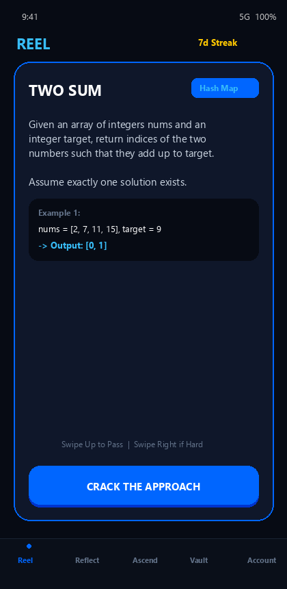
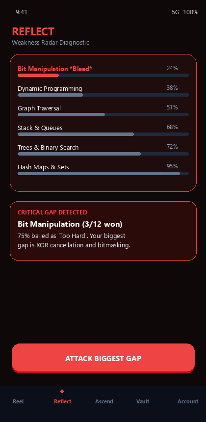
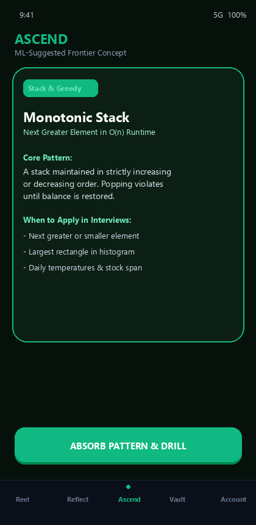
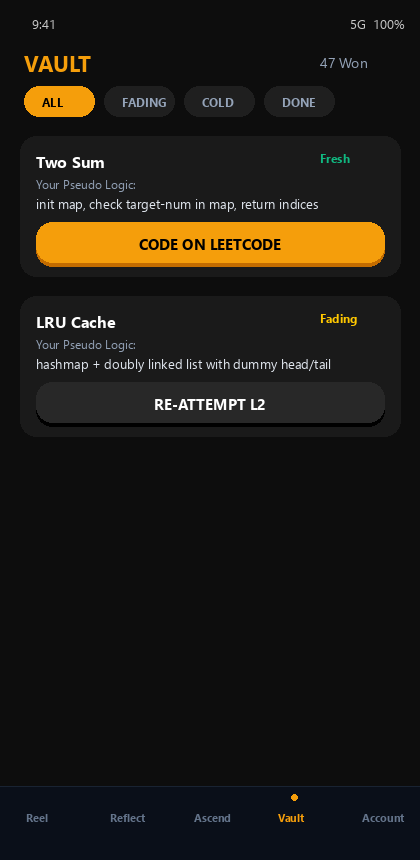
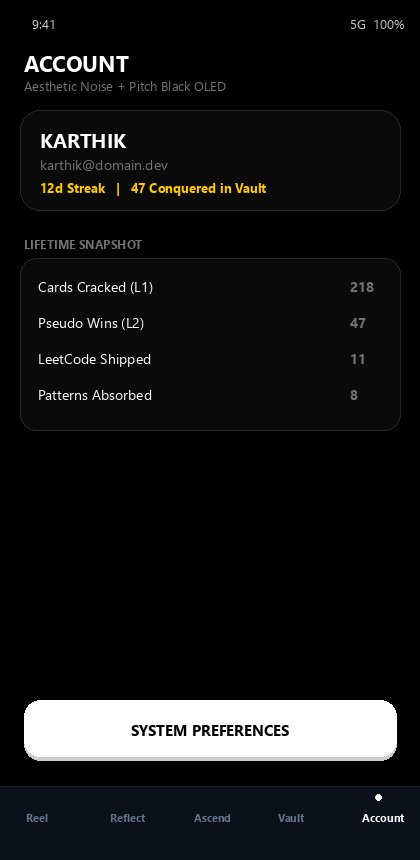

# LeetLingo 🧠⚡

> **Watch LeetCode as an infinite vertical feed. Identify approaches, iterate on pseudo-code, and conquer interview patterns without the dread.**

LeetLingo combines TikTok-style vertical mechanics with Duolingo's tactile 3D gamification and spaced repetition, designed entirely in **Kotlin + Jetpack Compose** for Android.

---

## 📱 App Screenshots

| 🎬 Reel Mode (Electric Blue) | 🪞 Reflect Mode (Crimson Red) | 🚀 Ascend Mode (Emerald Green) |
|:---:|:---:|:---:|
|  |  |  |

| 🏛️ Vault (Amber Gold) | 👤 Account (Pitch Black + Aesthetic Grain) |
|:---:|:---:|
|  |  |

---

## 🧠 Core Psychology — The Three Laws

1. **The Itch 🪝**: Habitual opening triggered by emotion:
   - **Boredom** ➔ Open **Reel Mode** for micro-dopamine wins.
   - **Guilt** ➔ Open **Reflect Mode** to confront and plug diagnostic leaks.
   - **Ambition** ➔ Open **Ascend Mode** to absorb new conceptual frontiers.
2. **The Loop ♾️**: Infinite feed progression with variable reward scheduling (60% algorithmic patterns, 30% brain twisters, 10% wildcards).
3. **Zero Cognitive Load Rule 🎯**: Exactly **1 primary chunky action button** per screen, zero social clutter, and 14pt+ typography with monospace code snippets.

---

## 🎮 The Three-Level Mastery Flow

- **Level 1 (Approach Selection)**: Tap to crack the problem by identifying the optimal algorithmic technique out of 4 focused choices.
- **Level 2 (Pseudo Code Iteration)**: Write plain-English pseudo logic in a free-text area. The AI evaluates your keywords and logic until you win, revealing the production Python solution.
- **Level 3 (The Vault & LeetCode Launch)**: Conquered problems land in the Vault with spaced-repetition memory decay tags (`Fresh` ➔ `Fading` ➔ `Cold`). The user is encouraged to code on LeetCode without answer spoilers.

---

## 🛠️ Tech Stack & Architecture

- **Language**: Kotlin 2.0+
- **UI Framework**: Android Jetpack Compose (Material 3)
- **Design Tokens**: Duolingo 3D Chunky tactile elevations (`0 4px 0 rgba(0,0,0,0.2)`) + per-tab color signatures.
- **Cloud & Analytics**: Firebase Android BoM (`33.6.0`), Firebase Analytics, Firestore, Auth, `com.google.gms.google-services`.
- **Content Engine**: 100% decoupled JSON content pipeline stored in `assets/content/` for live AI batch ingestion.

---

## 🤖 Agentic Automation & Batch Workflows

Run one-click `.bat` scripts directly from the workspace root:

```bash
# Ingest AI content batch dynamically
ingest_content.bat

# Validate schema integrity, 4-option rules, and Python snippets
validate_content.bat

# Run the complete test simulation
run_workflow.bat
```

---

## 📂 Project Structure

```
leetlingo/
├── app/
│   ├── google-services.json          # Firebase Configuration
│   ├── src/main/
│   │   ├── assets/content/           # Decoupled Content Layer
│   │   │   ├── reels/reels.json      # Reel Problems & Brain Twisters
│   │   │   ├── concepts/concepts.json # Frontier Concepts
│   │   │   └── weaknesses/           # Diagnostic Radar Data
│   │   └── java/com/leetlingo/app/
│   │       ├── data/model/           # Kotlin Data Models
│   │       ├── data/repository/      # Asset & AI Ingestion Repository
│   │       ├── ui/components/        # 3D Chunky Buttons & Cards
│   │       ├── ui/screens/           # Compose Screens (Reel, Reflect, Ascend, Vault, Account)
│   │       └── ui/theme/Color.kt     # Tab Color Signatures
├── docs/screenshots/                 # UI Mockup Screenshots
├── scripts/                          # Content Generation & Simulation Scripts
└── *.bat                             # Agentic Workflow Automation Files
```
